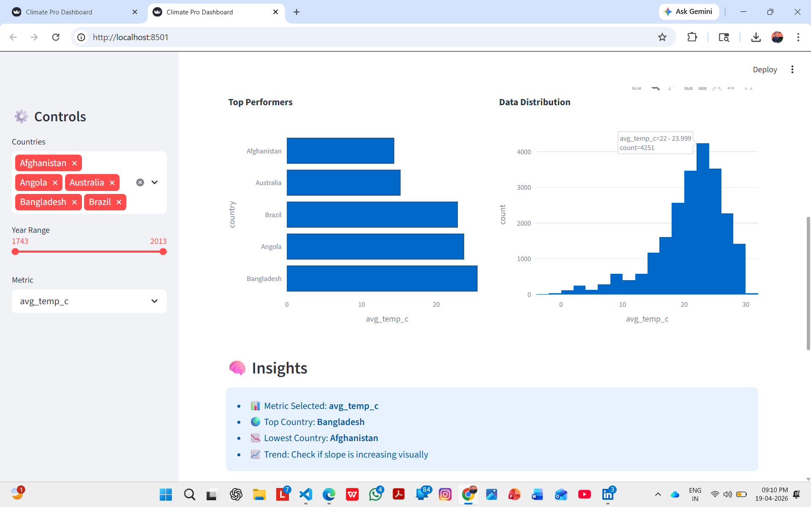
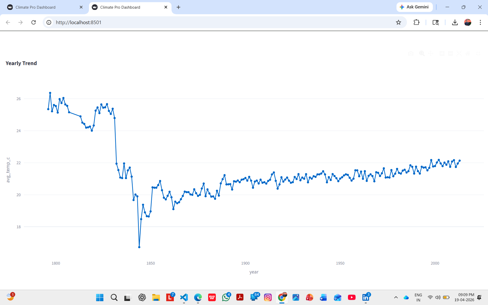
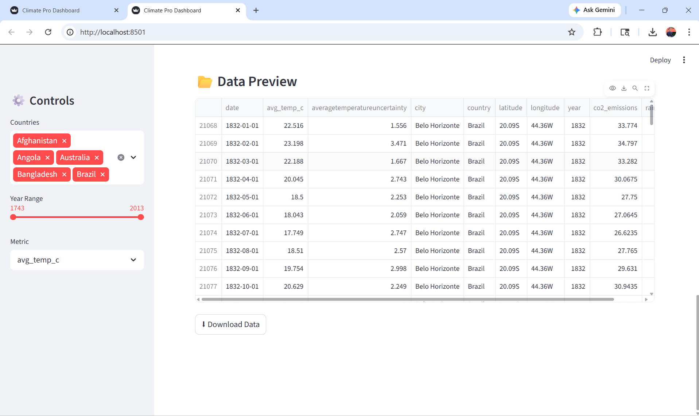
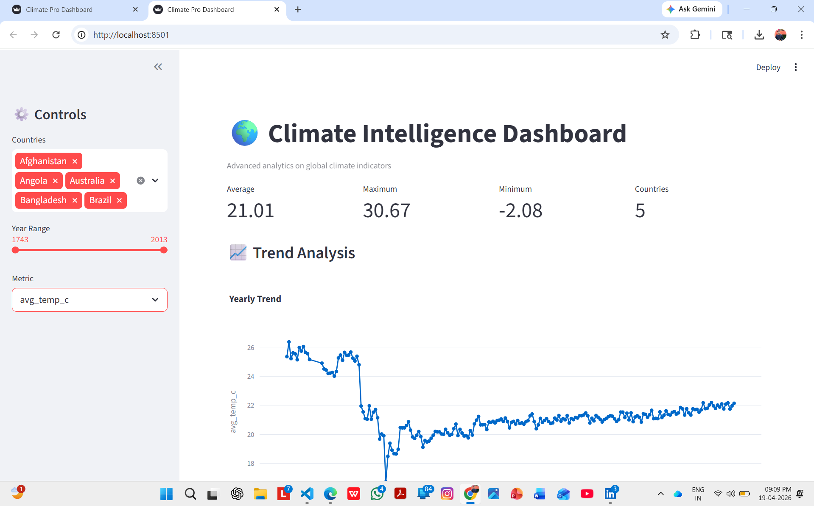

# 🌍 AI Climate Trend Analyzer (Data Science Project)


---

## 📌 Overview

This project is a **complete end-to-end Climate Analytics System** built using Python and Streamlit.

It transforms raw climate data into:

* 🌡 Temperature trend insights
* 🌧 Rainfall and environmental analysis
* 🌍 Country-level comparisons
* 📊 Interactive dashboards
* 📈 Time-series trend analysis
* 🧠 Decision-ready climate insights

---

## 📊 Dashboard Preview






---

## 🛠 Problem Statement

Climate data is complex and difficult to interpret:

* ❌ No centralized view of trends
* ❌ Hard to compare countries
* ❌ No visual insights for decision-making
* ❌ Raw datasets are not actionable

---

## ✅ Solution

This system:

* Cleans and preprocesses climate data
* Analyzes multiple environmental indicators
* Generates interactive dashboards
* Identifies trends and anomalies
* Provides decision-ready insights

---

## 🏭 Industry Relevance

| Industry         | Use Case                |
| ---------------- | ----------------------- |
| Climate Research | Environmental analysis  |
| Government       | Policy planning         |
| NGOs             | Climate impact tracking |
| Energy Sector    | Sustainability planning |
| Data Science     | Time-series forecasting |

---

## 📊 Business Impact

* ⚡ Faster climate analysis
* 📉 Reduced manual data processing
* 📈 Better environmental insights
* 🧠 Data-driven decisions

---

## ⚙ Tech Stack

* **Language:** Python
* **Data Processing:** Pandas, NumPy
* **Visualization:** Plotly
* **Dashboard:** Streamlit

---

## 📊 Dataset

Climate Dataset (Historical Environmental Data)

### Features:

* Date / Year
* Country
* Average Temperature
* Rainfall
* CO2 Emissions
* Sea Level Rise
* Renewable Energy %
* Extreme Weather Events
* Forest Area %

---

## 🏗 System Architecture

```
Raw Data → Data Cleaning → Feature Engineering → Analysis → Visualization → Insights → Dashboard
```

---

## 📁 Project Structure

```
AI-CLIMATE-TREND-ANALYZER/
├── app/
│   └── app.py
├── data/
│   ├── processed/
│   │   ├── cleaned_climate.csv
│   │   ├── climate_cleaned.csv
│   │   └── climate_data.csv
│   └── raw/
├── notebooks/
├── outputs/
├── src/
│   ├── analysis.py
│   └── forecasting.py
├── venv/
├── main.py
├── preprocess.py
├── README.md
└── requirements.txt
```

---

## ⚙ Installation & Setup

```
git clone https://github.com/maheshbhakre/expense-tracker-dashboard.git

cd AI-CLIMATE-TREND-ANALYZER

python -m venv venv
venv\Scripts\activate

pip install -r requirements.txt
```

---

## 🖥 Usage

### Step 1: Preprocess Data

```
python preprocess.py
```

### Step 2: Run Analysis

```
python main.py
```

### Step 3: Launch Dashboard

```
streamlit run app/app.py
```

---

## 📊 Key Visualizations

* 📈 Climate Trend Analysis
* 🌍 Country Comparison
* 📊 Multi-metric Benchmarking
* 📉 Environmental Indicators
* 🔍 Filter-based Insights

---

## 📸 Data Processing Proof

(Available in outputs folder)

---

## 🧠 Key Insights

* Temperature trends show long-term increase
* Certain countries dominate emissions
* Renewable energy adoption varies significantly
* Extreme weather events are increasing in frequency

---

## 👨‍💻 Author

**Mahesh Bhakre**

---

## 🌐 CONNECT WITH ME

<a href="https://github.com/maheshbhakre">

</a>

<a href="https://www.linkedin.com/in/maheshbhakreds1242">

</a>

<a href="https://www.instagram.com/mahesh_bhakre__2k06">

</a>

<a href="https://saimfsd.github.io/mahesh-portfolio/">

</a>

---

## ⭐ NOTE

This project demonstrates:

* Data Cleaning
* Feature Engineering
* Data Analysis
* Visualization
* Dashboard Development

---

## 🚀 Future Improvements

* Real-time climate monitoring
* AI-based forecasting models
* Alert system for anomalies
* Integration with live APIs
* Mobile dashboard version

---

## 🎯 Interview Tip

“I built an end-to-end Climate Trend Analyzer that processes environmental data, analyzes patterns, and visualizes insights through an interactive Streamlit dashboard.”
