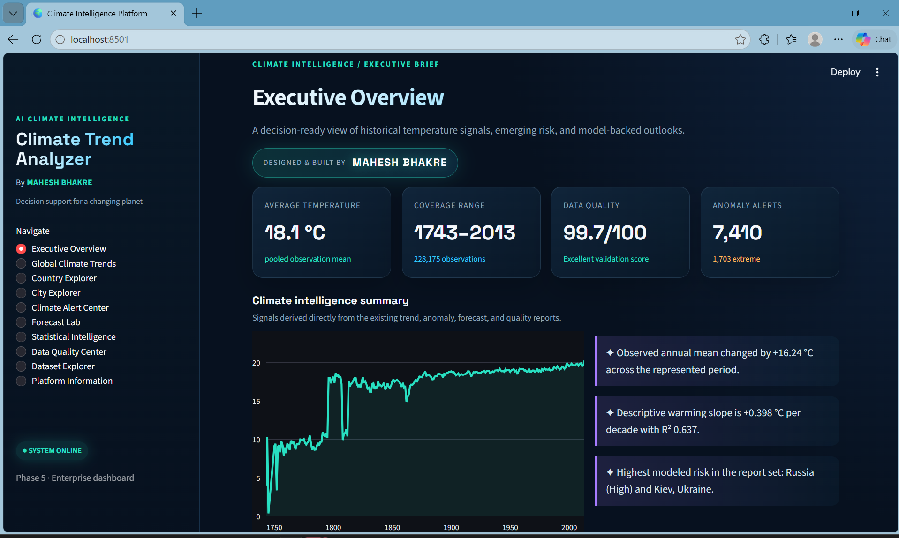
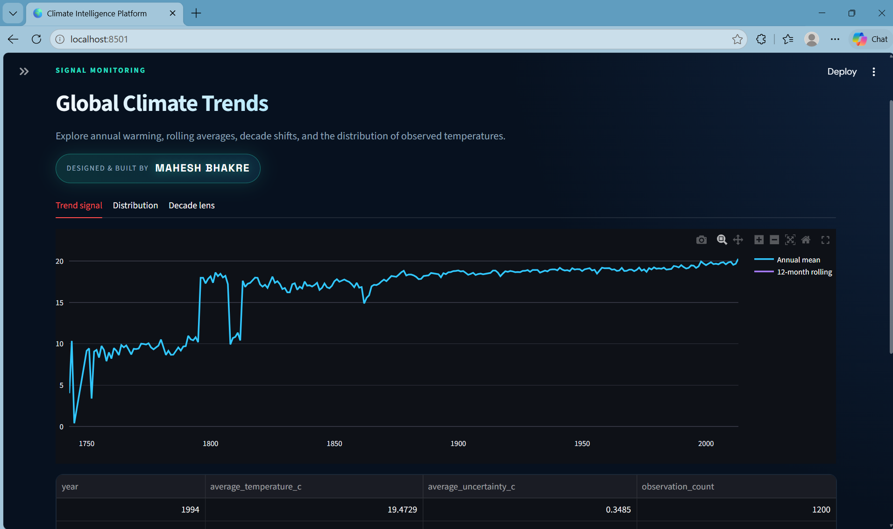
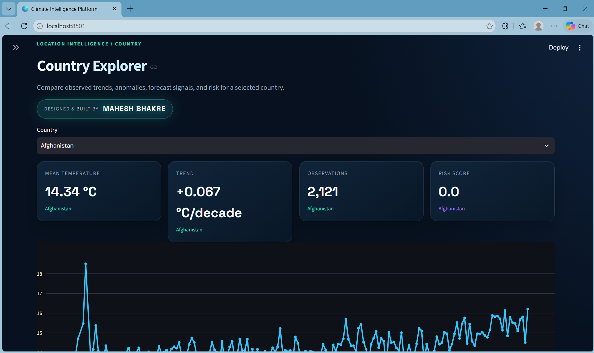
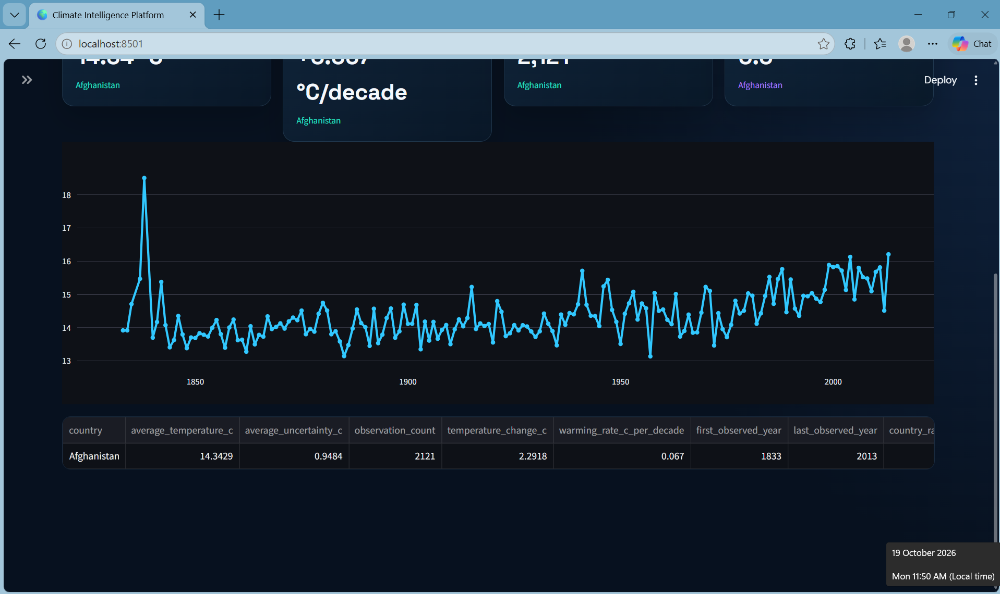
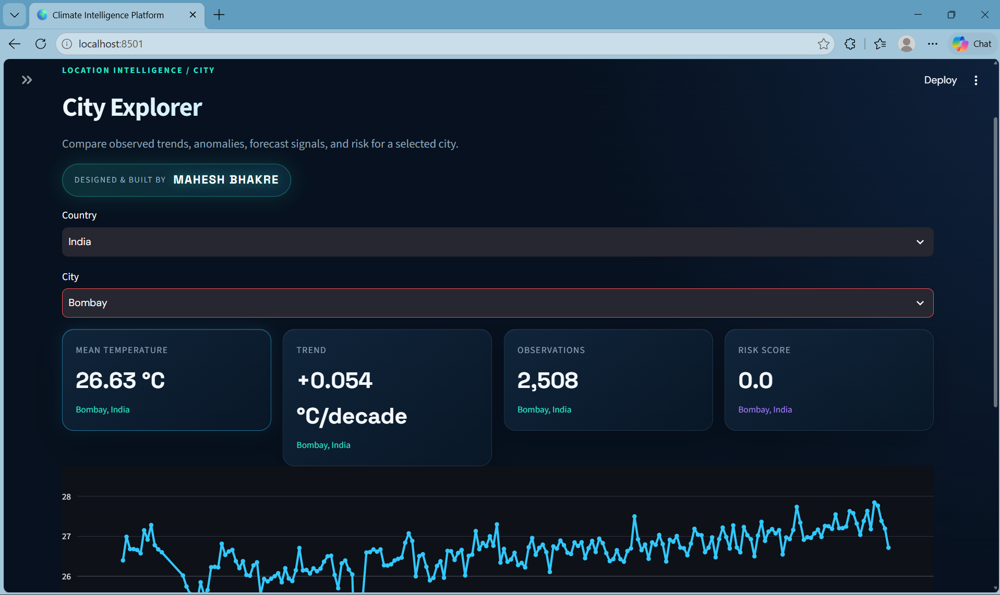
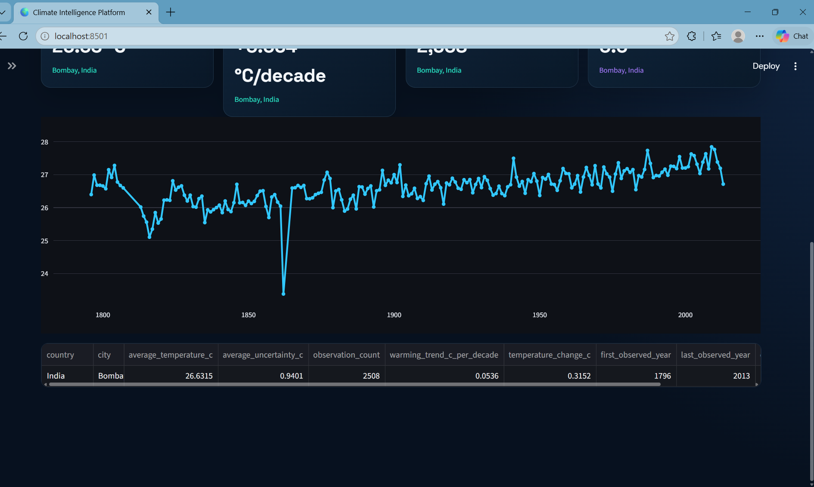
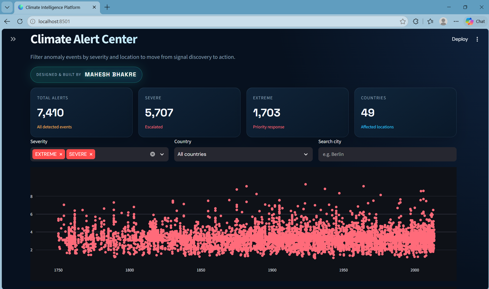
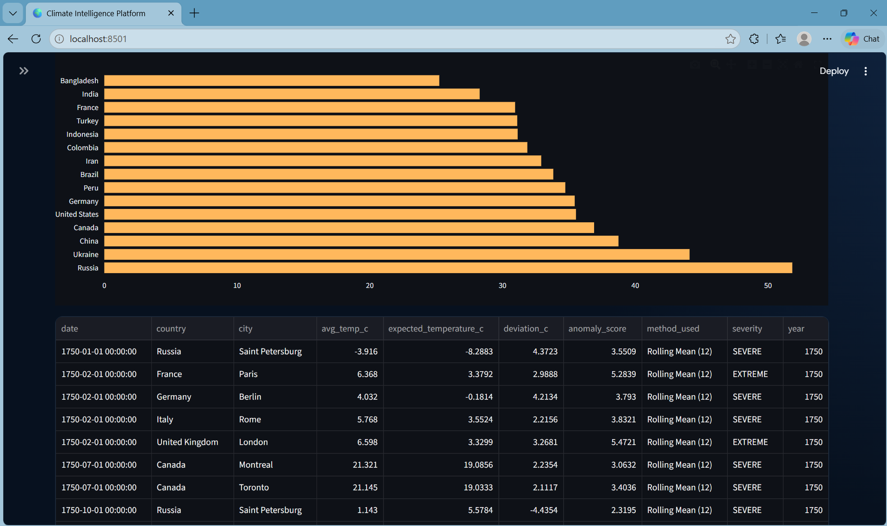
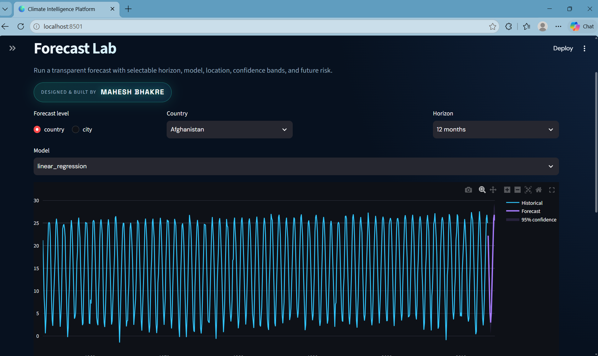
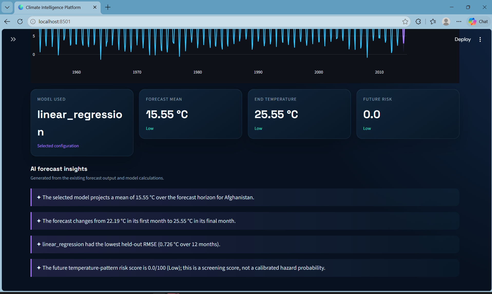

# Climate Trend Analyzer

An enterprise-style climate intelligence platform built with Python and Streamlit. It turns historical city-level temperature observations into traceable trends, anomaly signals, forecast scenarios, risk scores, and recruiter-ready visual storytelling.

**Author:** Mahesh Bhakre
**Dashboard:** `streamlit run app/app.py`

## Project overview

Climate data is difficult to communicate when exploration, statistical evidence, anomaly review, forecasting, and data quality are separated across notebooks. Climate Trend Analyzer brings those workflows into one dashboard while keeping the analytical engines and report artifacts auditable.

## Problem statement

Build a reproducible climate analytics workflow that can answer:

- How have observed temperatures changed over time?
- Which countries and cities show notable warming or anomaly patterns?
- What does a selected location's forward temperature pattern look like?
- How trustworthy, complete, and covered is the source dataset?

The source contains average temperature, uncertainty, date, city, country, latitude, and longitude. It does not contain rainfall, CO₂, sea level, renewable energy, or causal attribution variables.

## Screenshots

All PNG assets from `images/output/` are included below so GitHub renders the dashboard gallery directly in the project README.

### Executive overview



### Global climate trend



### Country explorer





### City explorer





### Climate alert center





### Forecast Lab





See [docs/dashboard_showcase_guide.md](docs/dashboard_showcase_guide.md) for the capture and visual QA checklist.

## Architecture

```text
data/raw/climate.csv
        |
        v
preprocess.py -> data/processed/climate_cleaned.csv
        |
        +--> data_validation.py  -> quality, schema, coverage reports
        +--> trend_analysis.py   -> trend, decade, seasonality, statistics
        +--> anomaly_engine.py   -> anomalies, alerts, risk rankings
        +--> forecast_engine.py  -> forecasts, metrics, confidence bands
        |
        v
app/app.py -> cached Streamlit presentation layer + Plotly visualizations
```

## Features

### Climate analytics

- Annual temperature trends
- Rolling averages
- Monthly seasonality and heatmaps
- Decade comparisons
- Country and city rankings
- OLS slope, R², correlation, confidence intervals, and interpretations

### Anomaly engine

- Seasonal Z-score, IQR, and rolling-deviation signals
- Moderate, severe, and extreme severity classes
- Historical temperature records
- Country/city anomaly risk scores
- Filterable Climate Alert Center

### Forecasting Lab

- Country and city forecasting
- 12, 24, 36, and 60-month horizons
- Linear regression, ARIMA, and seasonal-naive benchmark models
- Chronological holdout metrics
- Forecast confidence bands
- Future temperature-pattern risk screening
- AI forecast insights derived from forecast output and metrics

### Ultimate dashboard

- Executive Overview
- Global Climate Trends
- Country Explorer
- City Explorer
- Climate Alert Center
- Forecast Lab
- Statistical Intelligence
- Data Quality Center
- Dataset Explorer
- Platform Information

The UI uses a midnight-navy glassmorphism design system, unified Plotly styling, responsive CSS, accessible labels, cached loaders, hover motion, and visible author credit for **Mahesh Bhakre**.

## Installation

```powershell
py -3.10 -m venv venv
.\venv\Scripts\Activate.ps1
python -m pip install --upgrade pip
python -m pip install -r requirements.txt
```

## Usage

From the repository root:

```powershell
python preprocess.py
streamlit run app/app.py
```

The dashboard reads the canonical processed dataset and report artifacts under `outputs/reports/`. Missing report artifacts can be regenerated by the report-generation pipeline.

## Results and report artifacts

The repository includes quality, coverage, trend, anomaly, forecast, and statistical report outputs under `outputs/reports/`. These artifacts are the source of truth for dashboard cards and derived insights; the UI does not fabricate climate findings.

## Documentation

- [Project audit](docs/project_audit.md)
- [Data dictionary](docs/data_dictionary.md)
- [Climate analytics](docs/climate_analytics.md)
- [Climate anomaly engine](docs/climate_anomaly_engine.md)
- [Forecasting Lab](docs/forecasting_lab.md)
- [Dashboard design system](docs/dashboard_design_system.md)
- [Recruiter demo guide](docs/recruiter_demo_guide.md)
- [Dashboard showcase guide](docs/dashboard_showcase_guide.md)

## Validation

```powershell
pytest -q
python -m compileall -q app src tests preprocess.py main.py
python -m pip check
```

Tests cover data loading, validation, trend analysis, anomaly generation, and forecast engine behavior. Runtime validation should always be repeated after refreshing the source dataset.

## Limitations

- Coverage is uneven across locations and time.
- Row-wise means are not automatically population-weighted, area-weighted, or globally representative.
- Trend estimates are descriptive and not causal attribution.
- Anomaly flags are screening signals, not confirmed weather events or measurement errors.
- Future risk is a temperature-pattern screening score, not a calibrated hazard probability or loss model.
- Source publisher, license, and full unit provenance should be confirmed before formal redistribution or research publication.

## Future improvements

- Add a reproducible CI workflow for tests, lint, dependency checks, and screenshot smoke tests.
- Publish a versioned data provenance manifest and source citation.
- Add deployment configuration for Streamlit Community Cloud or container hosting.
- Add geography normalization and population/area-weighted aggregations.
- Add richer scenario analysis once additional climate indicators are available.

## Author information

**Mahesh Bhakre** — Data Science, climate analytics, forecasting, Streamlit product design, Plotly visualization, and open-source project maintenance.
